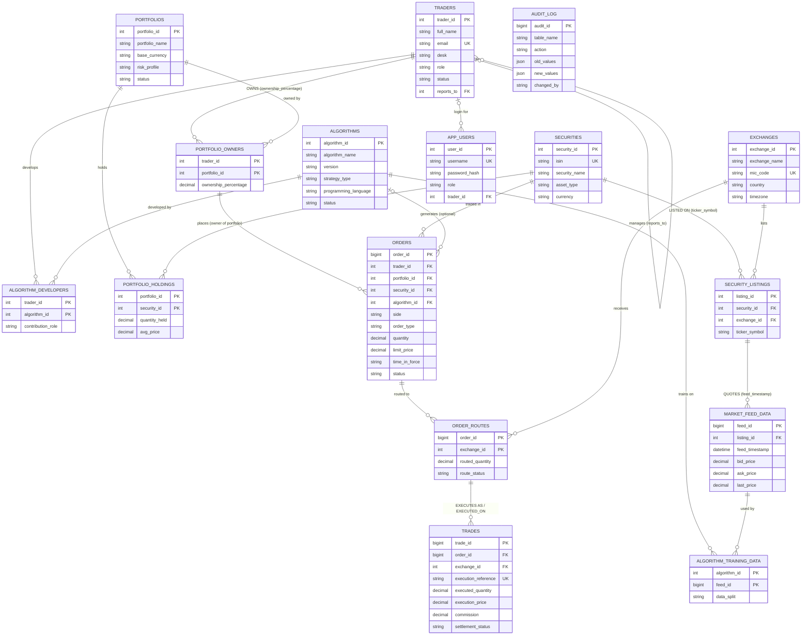

# ER diagram

GitHub renders the diagram below automatically (Mermaid). **For the submission**, paste the code block into <https://mermaid.live>, export a PNG/SVG, save it as `docs/er_diagram.png` and embed it here.

`AUDIT_LOG` has no foreign keys on purpose: it is a history table written by triggers and must survive deletions.

## MongoDB side (linked by id, not by foreign key)

| Collection | Key fields | Links to MySQL |
|---|---|---|
| `backtest_results` | `algorithm_id`, `run_label`, `metrics{}`, `parameters{}`, `equity_curve[]`, `tags[]`, `status` | `algorithms.algorithm_id` |
| `order_events` | `order_id`, `event_type`, `ts`, `source`, `payload{}` | `orders.order_id` |
